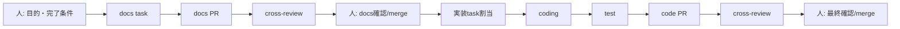

# agent-workflow

AIエージェント開発の目的・task・phase・test・PR・参照資料を一つの状態として扱い、
tmux monitorで見えるようにするための独立repositoryである。

## repositoryの境界

このrepositoryは、移行完了後に`10-agent-tools`の後継として利用する。

| repository | 責務 |
|---|---|
| `10-agent-tools` | 移行元。既存のtmux起動、pane通知、cross-review、review inbox |
| `11-agent-workflow` | copyした運用機能 + 目的/task metadata、heartbeat、reference解決、monitor表示 |
| application repository | 製品コード、docs、実装PR、テスト |

移行中は`10-agent-tools`を動作確認用の移行元として使う。移行完了後はworkspaceのlauncher、
monitor、cross-reviewの参照先を`11-agent-workflow`へ切り替え、旧repositoryをread-only archiveにする。
review protocol、cron、inbox、PR label、review上限のbehaviorはcopy後も維持する。

## 目標の流れ



## 設計資料

- [architecture.md](docs/architecture.md) — repository境界とコンポーネント構成
- [workflow.md](docs/workflow.md) — docs reviewからcode reviewまでの状態遷移
- [context-and-references.md](docs/context-and-references.md) — screenshot/reference folder設定
- [monitor.md](docs/monitor.md) — 現在のcross-review表示を残したmonitor設計
- [implementation-plan.md](docs/implementation-plan.md) — Python/shell実装、段階導入、test計画
- [migration-from-10-agent-tools.md](docs/migration-from-10-agent-tools.md) — copy範囲、除外範囲、切替、rollback
- [behavior-lock.md](docs/behavior-lock.md) — copy manifest、old/new snapshot、parallel task検証

## Copied runtime

移行段階1では、`agent-notify/`と`cross-review/`へ10-agent-toolsのtracked runtimeをcopyしている。
直接使う入口は次のwrapperである。

```bash
bin/agent-start       # tmux agentsを起動
bin/agent-monitor     # monitorへ移動
bin/agent-status      # task/heartbeat/status metadata
bin/cross-review      # local cross-review
```

`cross-review/config.local.sh`、inbox、review report、runtime state、secretは各環境で作る。

## 最初の判断

最初はstatus metadataとmonitor表示だけを実装する。task自動割当、agent自動起動、自動mergeは
後回しにする。人の判断境界を保ったまま、現在の「何をしているか分かりにくい」問題を解消する。

## Phase 1 quick start

```bash
export WORKSPACE="$PWD"
bin/agent-status begin \
  --workspace "$WORKSPACE" --agent codex --task-id demo-001 \
  --repo aidabo/agent-workflow --repo-dir . --phase coding \
  --goal "Phase 1 status helperを確認"
bin/agent-status heartbeat --workspace "$WORKSPACE" --agent codex --task-id demo-001
bin/agent-status test --workspace "$WORKSPACE" --agent codex --task-id demo-001 \
  --test-status passed --test-summary "unit tests"
bin/agent-status sweep --workspace "$WORKSPACE" --stale-after-seconds 600
bin/agent-status context \
  --context-file "$WORKSPACE/agent-context.json" --project 01-ghost-front
bin/agent-status end --workspace "$WORKSPACE" --agent codex --task-id demo-001
```

statusは`${WORKSPACE}/.agent-workflow/state/tasks/`と`agents/`へ保存される。
context解決はJSONの`agent-context.json`とtask JSONを入力にし、secret pathは拒否する。

## Parallel tasks and review isolation

task状態は`task_id`ごとに独立したファイルへ保存する。同じagentが複数taskを持つ場合も、
agent indexには`active_task_ids`を保持し、monitorはagent × taskの行で表示する。一方のtaskを
`end`しても、他のtaskのbranch・test・review状態は変更しない。

agent indexの例:

```json
{
  "agent": "codex",
  "active_task_ids": ["runner-001", "stack-042"],
  "current_task_id": "stack-042"
}
```

task JSONが各taskのphase/state/testの正であり、agent indexは一覧・current taskの索引だけを持つ。

cross-reviewはPR単位の非同期状態であり、別taskのcoding/testを止めない。同じtaskのPRだけが
`code_review`状態になる。依存関係がある場合だけtask metadataの`blocked_by`で明示的に止める。

status更新はネットワークを呼ばず、task JSONをO(1)で更新する。monitor側はtmuxを短い間隔、
GitHub/cross-reviewを長い間隔で取得し、review待ちでcoding taskの更新を止めない。
`sweep`はcronやwatcherからheartbeatの期限ごとに実行する。`--heartbeat-interval-seconds`の
10倍未満のstale期限は拒否される。`context`の結果には解決済みpathとwarningsが出力される。
