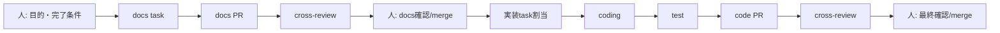

# agent-workflow

AIエージェント開発の目的・task・phase・test・PR・参照資料を一つの状態として扱い、
tmux monitorで見えるようにするための独立repositoryである。

## repositoryの境界

このrepositoryは`10-agent-tools`を置き換えない。

| repository | 責務 |
|---|---|
| `10-agent-tools` | 既存のtmux起動、pane通知、cross-review、review inbox |
| `11-agent-workflow` | 目的/task metadata、heartbeat、reference解決、monitor表示、workflow状態 |
| application repository | 製品コード、docs、実装PR、テスト |

`10-agent-tools`へは、既存の`cross-review`・tmux情報を読むためのadapterだけを持たせる。
既存のreview protocol、cron、inbox、PR label、review上限は変更しない。

## 目標の流れ



## 設計資料

- [architecture.md](docs/architecture.md) — repository境界とコンポーネント構成
- [workflow.md](docs/workflow.md) — docs reviewからcode reviewまでの状態遷移
- [context-and-references.md](docs/context-and-references.md) — screenshot/reference folder設定
- [monitor.md](docs/monitor.md) — 現在のcross-review表示を残したmonitor設計
- [implementation-plan.md](docs/implementation-plan.md) — Python/shell実装、段階導入、test計画

## 最初の判断

最初はstatus metadataとmonitor表示だけを実装する。task自動割当、agent自動起動、自動mergeは
後回しにする。人の判断境界を保ったまま、現在の「何をしているか分かりにくい」問題を解消する。

## Phase 1 quick start

```bash
export WORKSPACE="$PWD"
bin/agent-status begin \
  --workspace "$WORKSPACE" --agent codex --task-id demo-001 \
  --repo aidabo/agent-workflow --repo-dir . --phase coding \
  --goal "Phase 1 status helperを確認"
bin/agent-status heartbeat --workspace "$WORKSPACE" --agent codex --task-id demo-001
bin/agent-status test --workspace "$WORKSPACE" --agent codex --task-id demo-001 \
  --test-status passed --test-summary "unit tests"
bin/agent-status end --workspace "$WORKSPACE" --agent codex --task-id demo-001
```

statusは`${WORKSPACE}/.agent-workflow/state/tasks/`と`agents/`へ保存される。
context解決はJSONの`agent-context.json`とtask JSONを入力にし、secret pathは拒否する。
