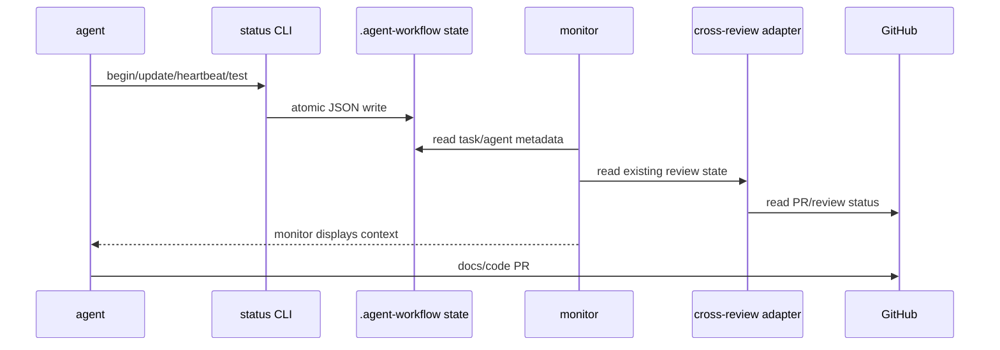

# Architecture

## 全体構成

## 責務境界

### 11-agent-workflowが持つもの

- task ID、目的、完了条件、parent docs PR、code PR
- agentのphase/state/task_status/heartbeat
- branch、commit、test結果の短い要約
- workspace/projectごとのscreenshot/reference設定
- stale・blocked・needs_humanの判定
- monitor用の集約表示

### 10-agent-toolsに残すもの

- tmux session/paneの起動
- paneへの通知
- cross-reviewのcron/watch
- reviewer選択、secret scan、inbox、PRコメント
- `PROTOCOL.md`のレビュー運用

新repositoryは`10-agent-tools`の内部ファイルを直接書き換えず、CLIまたは読み取りadapterで
状態を取得する。cross-reviewの状態は独自に再実装しない。

## データの流れ

## 安全境界

- statusへAPI key、token、会話全文、secret envを保存しない
- monitorはagent paneへ自動入力しない
- merge、deploy、AWS writeは人だけが実行する
- screenshot/referenceはbasenameとmetadataを表示し、無断で外部送信しない
- workspace外のpath、secret directory、`.env`、credential directoryは既定で拒否する
- 明示的に許可された非secretのworkspace外referenceだけwarning付きで許可する
