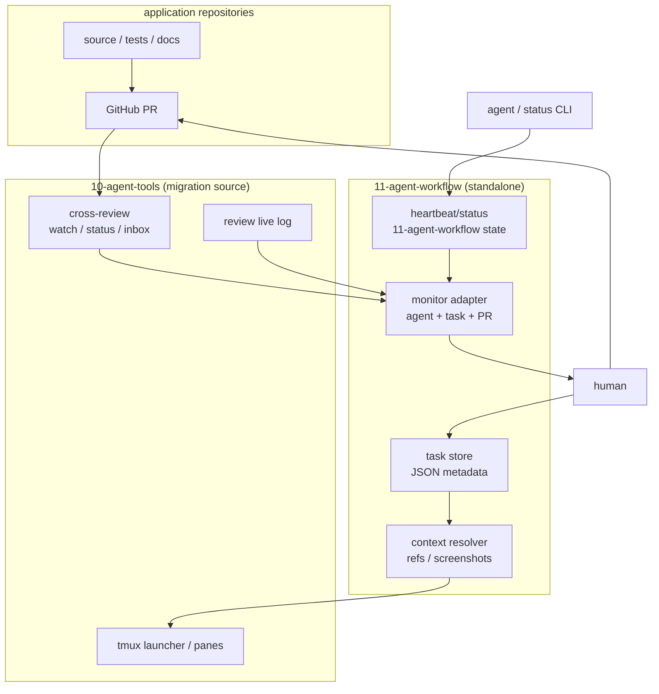
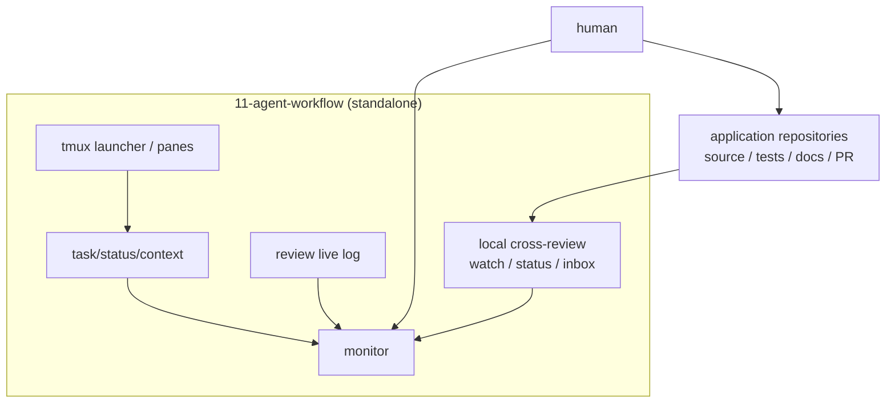
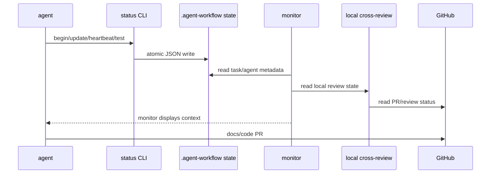

# Architecture

## 全体構成

### 移行中

### 移行後の目標

移行後はTMUX/CR/LIVEも`11-agent-workflow`内のcopyが実行主体になり、`10-agent-tools`は
read-only archiveになる。

## 責務境界

### 11-agent-workflowが持つもの

- task ID、目的、完了条件、parent docs PR、code PR
- taskごとのphase/state/task_status/heartbeat
- agent indexの`active_task_ids`と`current_task_id`
- branch、commit、test結果の短い要約
- workspace/projectごとのscreenshot/reference設定
- stale・blocked・needs_humanの判定
- monitor用の集約表示

task JSONが状態の正であり、agent JSONはactive taskの索引である。agentがtaskを切り替えても、
他taskのJSONは上書きしない。

task JSONはtaskごとに分かれるため、複数taskのstatus更新は互いに独立する。monitorのGitHub/
cross-review取得はstatus書き込みと別adapter/cacheで実行し、外部API待ちがagent更新を止めない。

### 移行後にagent-workflowが持つもの

- tmux session/paneの起動
- paneへの通知
- cross-reviewのcron/watch
- reviewer選択、secret scan、inbox、PRコメント
- `PROTOCOL.md`のレビュー運用

移行中はcopy元との差分を小さく保ち、copy後にstandalone codeとして動かす。
`10-agent-tools`のruntime state、local config、secret、`.git`、cacheはcopyしない。

## データの流れ

## 安全境界

- statusへAPI key、token、会話全文、secret envを保存しない
- monitorはagent paneへ自動入力しない
- merge、deploy、AWS writeは人だけが実行する
- screenshot/referenceはbasenameとmetadataを表示し、無断で外部送信しない
- workspace外のpath、secret directory、`.env`、credential directoryは既定で拒否する
- 明示的に許可された非secretのworkspace外referenceだけwarning付きで許可する
