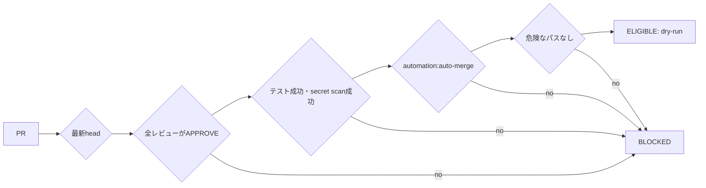

# Auto-merge gate（Phase 4 dry-run）

## 目的

configで指定された全レビュアーが、同じ最新 headに対して`APPROVE`したPRを機械的に判定する。
この段階では `gh pr merge` を呼ばず、判定結果だけを出す。既存の「マージは人が行う」という境界を壊さず、深夜運用で誤判定がないかを観測するためである。



## 使い方

```bash
bin/agent-merge-gate --repo=agent-workflow --pr=123
```

- exit `0`: `ELIGIBLE`。自動マージ可能な条件を満たしたが、まだmergeしない
- exit `2`: `BLOCKED`。理由を1行ずつ表示する
- その他: 設定・引数・GitHub取得エラー

判定は現在のPR headに紐づくreview reportだけを使用する。過去のheadで両方が承認していても、現在のheadにレポートがなければblockedになる。

## 必須条件

- open、draftではない、base branchが`main`
- `automation:auto-merge`ラベルが付いている
- configの全レビュアーにreportがあり、全員が`APPROVE`
- 各reportのテスト結果が実行済みかつ成功
- secret scanが成功
- `.github/`、`deploy/`、`infra/`、`migrations/`、`terraform/`、production用env/composeを変更していない

ラベルがないPRは、両方が`APPROVE`でも自動対象にならない。docsだけを自動化したい場合も、対象PRに明示的にラベルを付ける。

## GitHub側の設定（merge executor導入時）

Phase 4では設定だけ確認し、mergeは実行しない。将来executorを有効にする場合は、対象repositoryのSettingsで以下を設定する。

1. `main`をprotected branchまたはrulesetにする
2. pull requestを必須にする
3. required status checksを必須にする
4. conversation resolutionを必須にする
5. force pushを禁止する
6. Auto-mergeを許可する
7. executorは`gh pr merge --auto --squash`を使い、branch protectionを迂回しない

GitHubのrequired reviews・status checks・conversation resolutionはprotected branchで設定できる。Auto-mergeもrepository設定で有効化が必要である。

## dry-run観測

cross-reviewの`APPROVE`は現在、GitHubの正式review approvalではなくローカルreportとPRコメントである。また、agent-workflowの初期設計では人のmerge判断を残している。

対象PRに`automation:auto-merge`ラベルを付けた状態で、次を実行する。

```bash
bin/agent-merge-observe
tail -n 1 ~/.cache/agent-workflow/auto-merge-observe.jsonl
```

`agent-merge-observe`はサーバー側で`automation:auto-merge`ラベルを付けたopen PRだけを取得し、`bin/agent-merge-gate`の結果をJSONLへ追記する。ログには時刻、repository、PR、exit code、判定種別、判定理由が入り、`gh pr merge`は呼ばない。ログディレクトリは新規作成時だけ`0700`、ログは`0600`で作成する。既存の共有ディレクトリの権限は変更しない。

cronの例（5分間隔）は次のとおりである。

```cron
*/5 * * * * /path/to/11-agent-workflow/bin/agent-merge-observe >> $HOME/.cache/agent-workflow/auto-merge-observe.cron.log 2>&1
```

1週間観測し、`ELIGIBLE`の誤判定がないこと、`BLOCKED`の理由が想定内であること、GitHub API障害時にmerge操作が起きないことを確認する。cronでは`gh`と`python3`がPATHにあることを確認し、JSONLログは週次で退避またはrotateする。API一覧取得の失敗は`kind: list_error`として記録され、observerも非0で終了する。

## merge executor導入時

観測後、次の段階で初めてmerge executorを追加する。

1. dry-runをcronで1週間観測
2. `ELIGIBLE`と`BLOCKED`の誤判定がないことを確認
3. docs/testだけをallowlistにしてexecutorを別PRで追加
4. production設定、AWS、認証、DB、依存関係変更は常に人の確認にする

## 関連

- [workflow.md](workflow.md)
- [implementation-plan.md](implementation-plan.md)
- [monitor.md](monitor.md)
