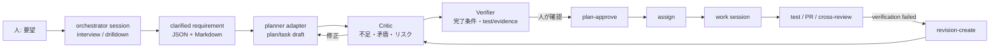

# AI Orchestrator Phase plan

## 目的

Phase 1〜5で、人がplan/taskを確認・承認し、agentへ明示assignする安全な実行基盤ができた。
次のAI Orchestrator Phaseでは、orchestrator sessionが要件をinterviewで明確化し、plan/taskのdraftを生成・検証する。
実行開始の承認境界は既存の`plan-approve`と`assign`に残す。



## session責務

### orchestrator session

- 背景、利用者、困りごと、期待結果、対象外、制約、完了条件を一問ずつ確認する
- 曖昧な点を`open_questions`として残す
- 仮定と人の承認状態を保存する
- 会話ログを正本にせず、clarified requirement artifactを正本にする

### planner / critic / verifier

- planner: clarified requirementからplan/taskのdraftを生成する
- critic: scope漏れ、循環依存、過大task、危険な仮定を指摘する
- verifier: acceptance criteria、test/evidence、revision条件を検証する
- いずれもtaskを実行せず、paneへ入力せず、assignしない

## clarified requirement schema

保存先: `<state-root>/requirements/<requirement_id>.json`

```json
{
  "requirement_id": "req-20261128-example",
  "status": "clarified",
  "background": "なぜ必要か",
  "users": ["利用者"],
  "problem": "現在の困りごと",
  "expected_result": "成功した状態",
  "scope": ["対象"],
  "non_goals": ["対象外"],
  "constraints": ["既存仕様・権限・互換性"],
  "acceptance_criteria": ["実行して確認できる条件"],
  "open_questions": [],
  "assumptions": [],
  "interview": {
    "mode": "targeted",
    "round": 2,
    "completed_at": "2026-11-28T00:00:00+00:00"
  },
  "created_at": "2026-11-28T00:00:00+00:00",
  "updated_at": "2026-11-28T00:00:00+00:00"
}
```

secret、token、password、pane入力、LLM会話全文は保存しない。既存のsafe ID、secret拒否、atomic write、0700/0600を再利用する。

## adapter境界

planner adapterは次の入力・出力だけを扱う。

```text
input:  clarified requirement JSON
output: plan draft + task drafts + assumptions + critic/verifier findings
```

provider（Codex、Claude、DeepSeek等）をstatus CLIへ直接埋め込まない。provider障害時はdraft生成を中断し、既存taskを変更しない。

## 承認・安全境界

- `open_questions`が残る場合、orchestratorは勝手に仮定を確定しない
- Critic/Verifierの指摘が未解決ならplanをapprovedにしない
- plan-approveは人の明示操作
- assignはapproved planの未着手taskだけ
- paneへの強制入力、自動merge、自動deployは対象外
- verification failedは元taskを上書きせず`revision-create`へ渡す

## 実装段階

1. requirement artifactの保存・検証CLI
2. orchestrator sessionからartifactを作る対話入口
3. planner adapterのprovider非依存fixture
4. Critic/Verifierの結果をplanへ保存
5. plan/task review後に既存approve/assignへ接続

完了条件は、fixture入力から同じplan/task draftが再現でき、secretが保存されず、open questionがある場合にassignまで進まないことである。
