# AI Orchestrator Phase plan

この文書は既存の`orchestrator-interview-workflow-plan.md`と`requirement-task-assignment-pipeline-plan.md`を置き換えず、AI sessionとprovider adapterの追加契約を定義する。既存のtask/plan CLI契約は後者、利用者向け手順はrunbookを正本とする。

## 目的

Phase 1〜5で、人がplan/taskを確認・承認し、agentへ明示assignする安全な実行基盤ができた。
次のAI Orchestrator Phaseでは、orchestrator sessionが要件をinterviewで明確化し、plan/taskのdraftを生成・検証する。
実行開始の承認境界は既存の`plan-approve`と`assign`に残す。

```mermaid
flowchart LR
  H[人: 要望] --> I[orchestrator session\ninterview / drilldown]
  I --> R[clarified requirement\nJSON + Markdown]
  R --> P[planner adapter\nplan/task draft]
  P --> C[Critic\n不足・矛盾・リスク]
  C -->|修正| P
  C --> V[Verifier\n完了条件・test/evidence]
  V -->|人が確認| A[plan-approve]
  A --> S[assign]
  S --> W[work session]
  W --> E[test / PR / cross-review]
  E -->|verification failed| X[revision-create]
  X --> S
```



## session責務

### orchestrator session

- 背景、利用者、困りごと、期待結果、対象外、制約、完了条件を一問ずつ確認する
- 曖昧な点を`open_questions`として残す
- 仮定と人の承認状態を保存する
- 会話ログを正本にせず、clarified requirement artifactを正本にする

### planner / critic / verifier

- planner: clarified requirementからplan/taskのdraftを生成する
- critic: scope漏れ、循環依存、過大task、危険な仮定を指摘する
- verifier: acceptance criteria、test/evidence、revision条件を検証する
- いずれもtaskを実行せず、paneへ入力せず、assignしない

## clarified requirement schema

保存先: `<state-root>/requirements/<requirement_id>.json`

```json
{
  "requirement_id": "req-20261128-example",
  "status": "clarified",
  "risk_level": "medium",
  "background": "なぜ必要か",
  "users": ["利用者"],
  "problem": "現在の困りごと",
  "desired_outcome": "成功した状態",
  "scope": ["対象"],
  "non_goals": ["対象外"],
  "constraints": ["既存仕様・権限・互換性"],
  "acceptance_criteria": ["実行して確認できる条件"],
  "open_questions": [],
  "assumptions": [],
  "interview": {
    "mode": "targeted",
    "round": 2,
    "completed_at": "2026-11-28T00:00:00+00:00"
  },
  "created_at": "2026-11-28T00:00:00+00:00",
  "updated_at": "2026-11-28T00:00:00+00:00"
}
```

`desired_outcome`と`risk_level`は既存のinterview/runbook語彙に合わせる。plan JSONのusers/scope/acceptance criteriaは、このartifactから転記し、`requirement_id`も保持する。
`acceptance_criteria`が空、または`open_questions`が残る場合は`needs_clarification`、両方が満たされる場合は`clarified`になる。`round`は1以上で、未完了interviewには`completed_at`を付けない。

secret、token、password、pane入力、LLM会話全文は保存しない。既存のsafe ID、secret拒否、atomic write、0700/0600を再利用する。

## adapter境界

planner adapterは次の入力・出力だけを扱う。

```text
input:  clarified requirement JSON
output: plan draft + task drafts + assumptions + critic/verifier findings
```

provider（Codex、Claude、DeepSeek等）をstatus CLIへ直接埋め込まない。provider障害時はdraft生成を中断し、既存taskを変更しない。

## 承認・安全境界

- **既存**: `open_questions`が残る場合、orchestratorは勝手に仮定を確定しない
- **既存**: `plan-approve`は`ai_review.status=approved`でないplan-review済みplanを拒否する。`ai_review`がないlegacy planは後方互換で許可する。
- **Phase実装予定**: `plan-approve`はplanの`requirement_id`を辿り、open_questionsと未解決のCritic/Verifier findingsが残る場合に拒否する
- **既存**: plan-approveは人の明示操作
- **既存**: pipeline管理taskのassignはapproved planの未着手taskだけに限定される。legacy taskは既存互換のためplan承認なしでもassignできる
- **既存**: paneへの強制入力、自動merge、自動deployは対象外
- **既存**: verification failedは元taskを上書きせず`revision-create`へ渡す
- **Phase実装予定**: revision-create後にCritic/Verifierを再実行するゲートを追加する。現行CLIはrevision taskをapproved planへ追加し、既存assignへ渡す。approved planを再承認する流れにはせず、revision task単位で再検証する。

## 実装段階

1. requirement artifactの保存・検証CLI（実装済み）
2. orchestrator sessionからartifactを作る対話入口（未実装。現在は`requirement-create`でfixture相当の入力を受ける）
3. planner adapterのprovider非依存fixture（実装済み）
4. Critic/Verifierの結果をplanへ保存（実装済み: plan-review）
5. plan/task review後に既存approve/assignへ接続（実装済み: plan-review gate）
6. 実provider adapterとinteractive session（未実装）

完了条件は、fixture入力から同じplan/task draftが再現でき、secretが保存されず、open questionがある場合にpipeline taskのapprove/assignまで進まないことである。Critic/plannerの反復は上限を持ち、上限到達や未解決findingは`needs_human`で停止する。
