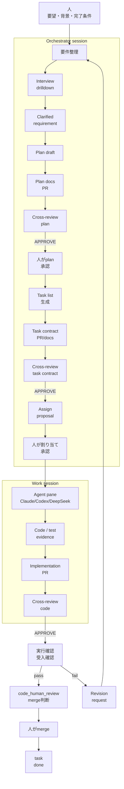

# Orchestrator / Work session workflow企画書

## 1. 結論

agentを2種類のsessionに分離する。

- **orchestrator session**: 要件をinterviewで明確化し、plan/taskを生成・レビュー・割り当てる
- **work session**: 割り当て済みtaskを実装し、test・PR・修正を行う

orchestratorはproduct codeを編集しない。work agentは未承認の要件を勝手にtask化しない。
plan、task、PR、実行確認の各段階をcross-reviewで確認できるようにする。

基準点は`v0.2.0`。この企画はpipeline実装前の設計であり、実装は別branchで行う。

## 2. 全体フロー



## 3. sessionの責務

### 3.1 Orchestrator session

orchestratorは計画を扱う専用pane/sessionであり、work agentと分離する。

担当:

- interviewを一問ずつ進める
- 要望、背景、利用者、制約、非対象、完了条件を整理する
- 曖昧な点を仮定で埋めず、`open_questions`として残す
- clarified requirementからplan draftを作る
- planからtask list、依存関係、割り当て候補を作る
- plan/task docs PRを作り、cross-reviewへ出す
- 実行確認が失敗したとき、元taskを上書きせずrevision taskを作る
- taskのassign/unassign/reconcileをCLI経由で行う

禁止:

- 承認前のtaskをagentへ割り当てる
- work agentのbranchでproduct codeを変更する
- paneの会話だけをtaskの正本にする
- cross-reviewの指摘を黙って破棄する

### 3.2 Work session

work sessionはClaude/Codex/DeepSeekなどの実行paneである。

担当:

- assigned taskのgoal、summary、acceptance criteriaを読む
- `begin`、heartbeat、test、checkpoint、endをtask ID付きで更新する
- 実装、テスト、PR作成、code cross-review対応を行う
- 要件の不足や実行不能をorchestratorへ返す

禁止:

- plan/taskの意味を独断で変更する
- 別taskを勝手にcurrent taskへ切り替える
- 失敗したtaskをdoneにする
- pane入力だけで「完了」と扱う

## 4. Interview / drilldown契約

interviewは、最初の要望をそのまま実装taskに変換するためのものではない。

最低限、次を確定する。

```json
{
  "problem": "何が困っているか",
  "users": ["誰が使うか"],
  "desired_outcome": "どうなれば成功か",
  "scope": ["今回含めるもの"],
  "non_goals": ["今回含めないもの"],
  "constraints": ["既存仕様・権限・性能・期限"],
  "acceptance_criteria": ["確認可能な完了条件"],
  "open_questions": [],
  "assumptions": [],
  "risk_level": "low|medium|high"
}
```

interviewの終了条件:

- `open_questions`が空、または人が未解決のまま進めると明示した
- acceptance criteriaが検証可能
- non-goalsが明確
- plan化してよいと人が確認した

oh-my-codex / oh-my-claudeのinterview式は、orchestratorの対話方式として参考にできる。
ただし、interviewの会話履歴そのものを正本にはせず、最終的にJSON/Markdownの要件成果物へ固定する。

## 5. Plan / Task / PRのcross-review

### Plan review

確認対象:

- 要件とscopeが一致しているか
- acceptance criteriaが検証可能か
- non-goalsとリスクが抜けていないか
- 既存architectureと矛盾しないか

### Task contract review

確認対象:

- taskの粒度がwork agent一回分として妥当か
- task間の依存関係が明確か
- agent割り当て候補が適切か
- acceptance criteriaとtest/evidenceが対応しているか
- taskの重複・抜け・循環依存がないか

### Code review

既存cross-reviewをそのまま使う。plan/task reviewとcode reviewは別の判定単位にする。
planがAPPROVEでも、code PRは別にreviewする。

## 6. Revision / 再task生成

実行確認に失敗したとき、元taskを直接書き換えて履歴を失わない。

```text
task-001 revision=0
  → work agent実行
  → verification failed
  → task-001-r1 revision task
  → orchestratorが差分と原因を記録
  → 再assign
```

revision taskには次を残す。

- `parent_task_id`
- `revision`
- `failure_reason`
- `previous_evidence`
- `changed_acceptance_criteria`
- `new_next_action`

単なる実装上の修正は同じcode PRで扱い、要件・task契約が変わる場合だけorchestratorへ戻す。

## 7. 状態モデル

既存の`phase / state / task_status`の3軸を維持する。

```text
plan draft / plan review / plan approved are plan.status values, not task phases.
  → task planned: phase=docs / task_status=ready / state=idle
  → task assigned: phase=assigned / task_status=in_progress / state=busy
  → task running:  phase=coding / task_status=in_progress / state=busy
  → task evidence: phase=test / task_status=in_progress / state=busy
  → code review:   phase=code_review / task_status=ready_for_review / state=waiting_user
  → verification: phase=test / task_status=in_progress / state=busy; agentがevidenceを記録
      ├─ pass: phase=code_human_review / task_status=ready_for_review / state=waiting_user
      │          → 人がmerge → phase=done / task_status=done / state=done
      └─ fail: revision taskへ戻る
```

pipeline管理task（`pipeline_managed=true`）は、人のassign承認なしに`begin`できない。assign済みの
別taskをbeginする場合も、明示assignを要求する。legacy task（このflagがない既存task）は互換性の
ためassignなしbeginを許可し、current taskへ設定する。別taskのheartbeat/updateはcurrent taskを
上書きしない。これは現行status実装からの変更であり、Phase 3で`status.py`と既存テストを更新する。

## 8. 実装フェーズ

### Phase 0: 成果物とreview契約

- clarified requirement schema
- plan schema
- task contract schema
- plan/task docs PRをcross-reviewへ出すCLI/手順

### Phase 1: Orchestratorのdraft生成

- interview成果物の保存
- plan draft生成
- task list生成
- 人の承認前はassign不可

### Phase 2: Assign / reconcile

- `agent-status assign/unassign/reconcile`
- task JSONとagent indexのlock/atomic更新
- done/staleのassign拒否
- 片側更新の検出・修復

### Phase 3: Work session接続

- assigned taskのbegin/heartbeat/test/end
- current taskの一意表示
- paneへのtask context通知
- task evidenceとacceptance criteriaの記録
- pipeline taskのassign必須、legacy taskのassignなしbegin互換、別task heartbeatによるcurrent task上書き禁止、既存テスト更新

### Phase 4: Revision loop

- `revision-create`でfailure reasonとprevious evidenceを残したrevision taskを作成
- verification failedの記録
- revision task生成
- 再assign・再review
- 同じtaskの無限再試行を上限/needs_humanで停止

## 9. 初期リリースの境界

初期版では、orchestratorはplan/taskをdraftし、人が承認してassignする。
完全自動の要件分解、無人assign、paneへの強制入力、自動merge、自動deployは対象外とする。

初期版が安定した後、planner agentによるdraft生成、assign候補の提案、受入確認の自動補助を追加する。

