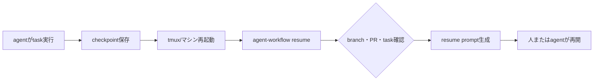

# Phase 5: checkpoint / resume

## 目的

tmux detach、tmux server停止、マシン再起動後でも、agentが前回のtaskを安全に再開できるようにする。

現在、task JSON・PR・review reportは保存されるが、pane内agentの会話と「次に何をするか」はプロセス終了後に失われる。Phase 5では、会話そのものを復元するのではなく、再開に必要な作業状態をcheckpointとして保存する。



## 保存場所

```text
<workspace>/.agent-workflow/state/tasks/<task-id>.json
<workspace>/.agent-workflow/state/agents/<agent>.json
<workspace>/.agent-workflow/state/checkpoints/<task-id>.json
```

checkpointはtask stateと同じworkspaceに置く。旧`10-agent-tools`のstateやreportとは共有しない。
directoryは`0700`、fileは`0600`を維持する。

## checkpointの内容

```json
{
  "task_id": "runner-001",
  "agent": "codex",
  "workspace": "/home/aidabo/work/legacy",
  "checkpoint_at": "2026-11-23T12:00:00+00:00",
  "phase": "coding",
  "task_status": "in_progress",
  "state": "busy",
  "goal": "runnerの構成を修正する",
  "repo": "aidabo/example",
  "repo_dir": "/home/aidabo/work/legacy/example",
  "branch": "feat/runner-config",
  "pr": 123,
  "test": {"status": "passed", "summary": "unit tests"},
  "next_action": "レビュー指摘の中2件を修正する",
  "references": ["docs/deploy/", "images/Screenshot_20.png"]
}
```

秘密値、token、password、`.env`の内容は保存しない。referenceは許可されたpath名だけを保存する。

## command設計

```bash
bin/agent-workflow checkpoint \
  --workspace "$PWD" --agent codex --task-id runner-001 \
  --next-action "レビュー指摘を修正してtestする"

bin/agent-workflow resume --workspace "$PWD"
```

`checkpoint`はtaskの現在状態を読み、branch、PR、test、next actionを保存する。taskのphaseやstatusを勝手に変更しない。

`resume`は次を出力する。

- staleまたは未完了task一覧
- 最終checkpoint時刻
- branch、PR、test状態
- 未完了のnext action
- agent paneへ渡すresume prompt
- branch・PR・workspaceの不一致warning

初期版の`resume`は表示・prompt生成までとし、agent paneを自動再起動しない。重複実装や同じPRへの二重pushを防ぐためである。

## 再起動後の運用

```bash
cd /home/aidabo/work/legacy/11-agent-workflow
export AGENT_WORKFLOW_WORKSPACE=/home/aidabo/work/legacy

bin/agent-workflow agent
bin/agent-workflow resume --workspace "$AGENT_WORKFLOW_WORKSPACE"
bin/agent-workflow monitor
```

resume promptを確認してから、該当するagent paneへ次のように指示する。

```text
このtaskは再開です。resume outputを確認し、同じbranchの未完了作業から続けてください。
新しいPRや重複したpushは作らないでください。
```

## 状態別の扱い

| 状態 | resume時の扱い |
|---|---|
| `coding` / `test` | staleなら人が確認して再開 |
| `code_review` | 現在のPR・最新head・inboxを確認 |
| `needs_human` | 自動再開しない。人の指示を待つ |
| `done` | resume対象外 |
| branch消失 | warningを出して人の判断を待つ |
| PRがclosed/merged | taskを自動変更せず、人に通知 |

## 将来の拡張

checkpoint/resumeが安定した後に、明示的な`--auto-resume`を検討する。ただし次を満たす場合だけにする。

- 同じtaskを実行するagentがいない
- branchとworkspaceが一致する
- PRがopenである
- 未commit変更を検出している
- `needs_human`ではない
- 人がauto-resumeを有効にしている

agentの会話履歴を完全復元することや、マシン再起動直後に全agentを無条件で起動することは初期範囲に含めない。
