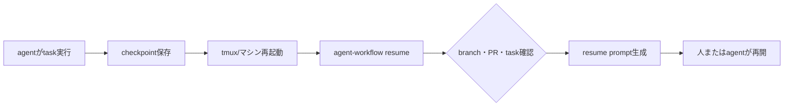

# Phase 5: checkpoint / resume

初期実装ではcheckpoint保存、resume候補表示、完了taskのcheckpoint pruneを提供する。paneの自動再起動とcheckpoint履歴の自動pruneは将来拡張とする。

## 目的

tmux detach、tmux server停止、マシン再起動後でも、agentが前回のtaskを安全に再開できるようにする。

現在、task JSON・PR・review reportは保存されるが、pane内agentの会話と「次に何をするか」はプロセス終了後に失われる。Phase 5では、会話そのものを復元するのではなく、再開に必要な作業状態をcheckpointとして保存する。



## 保存場所

```text
<workspace>/.agent-workflow/state/tasks/<task-id>.json
<workspace>/.agent-workflow/state/agents/<agent>.json
<workspace>/.agent-workflow/state/checkpoints/<task-id>.json
```

checkpointはtask stateと同じworkspaceに置く。旧`10-agent-tools`のstateやreportとは共有しない。
directoryは`0700`、fileは`0600`を維持する。

## checkpointの内容

```json
{
  "schema_version": 1,
  "task_id": "runner-001",
  "agent": "codex",
  "workspace": "${WORKSPACE}",
  "checkpoint_at": "2026-11-23T12:00:00+00:00",
  "phase": "coding",
  "task_status": "in_progress",
  "state": "busy",
  "goal": "runnerの構成を修正する",
  "repo": "aidabo/example",
  "repo_dir": "${WORKSPACE}/example",
  "branch": "feat/runner-config",
  "head_sha": "0123456789abcdef0123456789abcdef01234567",
  "pr": 123,
  "test": {"status": "passed", "summary": "unit tests"},
  "review": {"status": "changes_requested", "summary": "review指摘を修正する", "updated_at": "2026-11-23T12:00:00+00:00"},
  "next_action": "レビュー指摘の中2件を修正する",
  "references": ["docs/deploy/", "images/Screenshot_20.png"]
}
```

秘密値、token、password、`.env`の内容は保存しない。`next_action`と`references`にも既存の`reject_secret`相当の検査を適用する。referencesは`context-and-references.md`のdeny-by-default方針を再利用し、workspace/repository相対pathだけを保存する。

## command設計

```bash
bin/agent-workflow checkpoint \
  --workspace "$PWD" --agent codex --task-id runner-001 \
  --next-action "レビュー指摘を修正してtestする"

bin/agent-workflow resume --workspace "$PWD"
```

`checkpoint`はtaskの現在状態を読み、branch、PR、test、review、next actionを保存する。taskのphaseやstatusを勝手に変更しない。

`resume`は次を出力する。

- staleまたは未完了task一覧
- 最終checkpoint時刻
- branch、PR、test状態
- 未完了のnext action
- agent paneへ渡すresume prompt
- branch・PR・workspaceの不一致warning

初期版の`resume`は表示・prompt生成までとし、agent paneを自動再起動しない。重複実装や同じPRへの二重pushを防ぐためである。

resumeのJSON出力例：

```json
{
  "resume_candidates": [
    {
      "task_id": "runner-001",
      "phase": "coding",
      "task_status": "in_progress",
      "state": "stale",
      "branch": "feat/runner-config",
      "pr": 123,
      "head_sha": "01234567",
      "next_action": "レビュー指摘の中2件を修正する",
      "warning": ["task state is stale; human confirmation required"],
      "prompt": "同じbranchの未完了作業から続けてください。新しいPRや重複pushは作らないでください。"
    }
  ],
  "errors": []
}
```

## checkpointサイズとcleanup

monitorにはtaskごとに次を表示する。

```text
checkpoint 12KB · 4m ago
```

checkpointの内容を毎回読み込まず、file sizeとmtimeだけを取得する。既定のwarning閾値は`512KB`とし、超過した場合は`checkpoint oversized`を表示する。checkpointには大きなログやdiffを保存せず、test logやPR URLなどの参照だけを保存する。

初期実装ではtaskごとに最新checkpointを1件だけ保持する。古いcheckpointは、taskが`done`であることを確認し、未完了・不明・壊れたtaskを除外したdry-run結果を確認してから明示的に削除する。判定基準はcheckpoint fileのmtimeである。

```bash
# まず削除候補だけ表示
bin/agent-workflow checkpoint prune --workspace "$WORKSPACE" --older-than 30d

# 内容を確認してから削除
bin/agent-workflow checkpoint prune --workspace "$WORKSPACE" --older-than 30d --apply
```

自動削除は行わない。done taskのcheckpointも、最初は人が確認してから削除する。

## 再起動後の運用

```bash
cd "${WORKSPACE}/11-agent-workflow"
export AGENT_WORKFLOW_WORKSPACE="${WORKSPACE}"

bin/agent-workflow resume --workspace "$AGENT_WORKFLOW_WORKSPACE"
bin/agent-workflow agent
bin/agent-workflow monitor
```

resume promptを確認してから、該当するagent paneへ次のように指示する。

```text
このtaskは再開です。resume outputを確認し、同じbranchの未完了作業から続けてください。
新しいPRや重複したpushは作らないでください。
```

## 状態別の扱い

| phase | task_status | state | resume時の扱い |
|---|---|---|---|
| `docs` / `docs_review` | `planned` / `ready` / `in_progress` / `ready_for_review` | `busy` / `waiting_user` / `stale` | staleなら人が確認して再開 |
| `docs_human_review` | `ready_for_review` | `waiting_user` / `needs_human` | 人の確認を待つ |
| `assigned` / `coding` | `ready` / `in_progress` | `busy` / `stale` | branchと未commit変更を確認して再開 |
| `test` | `in_progress` | `busy` / `blocked` / `stale` | test結果を確認して再開 |
| `code_review` | `ready_for_review` | `busy` / `waiting_user` / `stale` | PR・最新head・inboxを確認 |
| `code_human_review` | `ready_for_review` | `waiting_user` / `needs_human` | 人のmerge判断を待つ |
| any | `needs_human` | `needs_human` / `blocked` / `stale` | 自動再開しない |
| `done` | `done` | `done` | resume対象外 |

branch消失、PRのclosed/merged、workspace不一致はphase/stateとは別の外部warningとして扱い、taskを自動変更しない。

## 将来の拡張

checkpoint/resumeが安定した後に、明示的な`--auto-resume`を検討する。ただし次を満たす場合だけにする。

- 同じtaskを実行するagentがいない
- branchとworkspaceが一致する
- PRがopenである
- 未commit変更がない、またはcheckpoint時点との差分を人が確認済み
- `needs_human`ではない
- 人がauto-resumeを有効にしている

agentの会話履歴を完全復元することや、マシン再起動直後に全agentを無条件で起動することは初期範囲に含めない。
