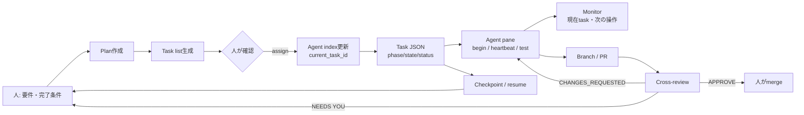
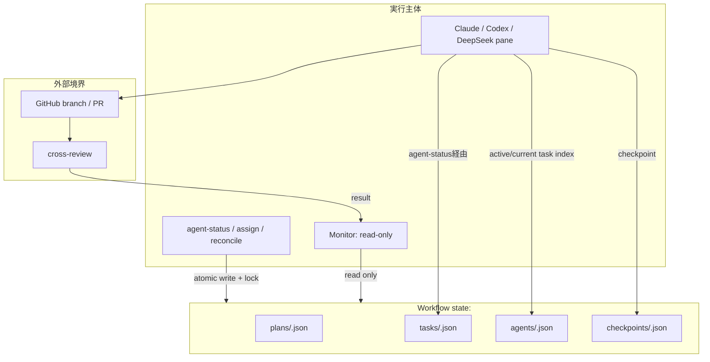

# 要件からagent割り当てまでのworkflow企画書

## 1. 目的

現在の`11-agent-workflow`は、task JSON、agent index、heartbeat、monitor、cross-reviewを持つが、
次の流れが未実装である。

```text
要件 → plan → task list → agent割り当て → agent実行 → test/review → 完了
```

本企画では、要件とplanから実行可能なtaskを作り、agentの`current_task_id`へ安全に割り当て、
monitorで「誰が何をしているか」を継続表示できる状態を作る。

## 1.1 全体概要図



### 責務境界



Monitorはtaskを作成・割り当て・修復しない。taskの作成と割り当てはCLI、人による確認はplan/taskの
承認、実作業はagent pane、外部レビューはcross-reviewが担当する。

## 2. 基準点と範囲

- 基準workflow: `v0.2.0`（PR #27までを含む安定点）
- pipeline実装は、この企画書PRとは別branch・別PRで行う
- 既存のcross-review、checkpoint、resume、monitor表示は壊さない
- agent paneへ勝手に入力する動作は初期範囲に含めない
- 外部API、GitHub issue、LLMによる自動分解は初期範囲に含めず、ローカルJSON契約から始める

## 3. 利用者の操作イメージ

```text
1. 人が要件と完了条件を書く
2. plannerがplanを作成する
3. planからtask listを生成する
4. 人がtaskとagentを確認する
5. assignでagentのcurrent_task_idを更新する
6. agentが同じtask_idで作業し、heartbeat/test/endを更新する
7. monitorがagentごとの内容・phase・次の操作を表示する
8. PR作成後は既存cross-reviewへ渡す
```

## 4. データ契約案

### 4.1 Plan

保存先: `<state-root>/plans/<plan_id>.json`（`AGENT_WORKFLOW_STATE_ROOT` / `--state-root`に従う）

plan directoryは`0700`、plan JSONは`0600`、書き込みは既存のatomic writeと同じ方式にする。

```json
{
  "plan_id": "plan-20261126-example",
  "requirement_id": "req-20261128-example",
  "title": "短い計画名",
  "requirement": "利用者が達成したいこと",
  "acceptance_criteria": ["確認可能な完了条件"],
  "task_ids": ["task-001", "task-002"],
  "status": "draft"
}
```

### 4.2 Task

既存の`.agent-workflow/state/tasks/<task_id>.json`を正本として拡張する。

必須または推奨フィールド:

- `task_id`: 安定したID
- `plan_id`: 所属plan
- `agent`: 割り当てagent。未割り当てはnull
- `summary`: monitorに表示する短い作業概要
- `goal`: 完了時に達成すること
- `next_action`: 次に行う操作
- `acceptance_criteria`: task固有の完了条件
- `phase`, `state`, `task_status`: 既存status契約に従う
- `branch`, `pr`, `test`: 実行後に更新

### 4.3 Agent index

既存の`.agent-workflow/state/agents/<agent>.json`を使用する。

- `active_task_ids`: 現在担当するtask
- `current_task_id`: monitorとresumeが表示・再開に使うtask
- `heartbeat_at`: agentの生存状態

割り当ては`<state-root>/assignment.lock`を先に取得し、task JSONをtask固有lockでatomic writeした後、
agent indexをagent固有lockでatomic writeする。ロック順は`assignment → task → agent`に固定する。
2ファイルを同時に置き換えるatomic transactionは既存status CLIに無いため、monitorは読み取り専用の
警告を出し、`agent-status reconcile`（Phase 2以降で実装）が片側更新を修復する。

`current_task_id`は`assign`が割り当て時に設定し、`begin`が同じtaskを開始するときだけ維持・確認する。
assignされていないtaskを`begin`した場合は、既存利用者との互換性のため従来どおりcurrentに設定する。
assign済みの別taskを`begin`する場合は、明示的な`assign`を先に要求する。別taskのheartbeat/updateは
current taskを勝手に切り替えない。これに伴うstatus実装と既存テストの更新はPhase 3で行う。

## 5. 状態遷移

```text
plan draft → plan approved → task planned
task assigned: phase=assigned / task_status=in_progress / state=busy（割り当て確定・着手待ち）
task running:  phase=coding  / task_status=in_progress / state=busy
task review:   phase=code_review / task_status=ready_for_review / state=waiting_user
task done:     phase=done / task_status=done / state=done
```

`assigned`はphase、`stale`はstate、`ready`/`in_progress`はtask_statusであり、同じ軸の値ではない。
割り当て解除、stale、needs_humanは通常の進行と分ける。

- `ready`: Phase 1のtask-createで作成された、agent未割り当ての実行準備済みtask。Phase 2以降でplan承認後にassignする
- `assigned`: agentとcurrent_task_idが確定した着手待ち。phase=assigned / task_status=in_progress / state=busy
- `in_progress`: begin後にphase=codingへ進み、agentが実作業中
- `stale`: heartbeat期限超過。自動再割り当てしない
- `needs_human`: 要件・権限・レビュー上限など人の判断が必要

## 6. CLI案

既存の`bin/agent-status` / `src/agent_workflow/status.py`へ段階的に追加する。
既存のsafe ID、secret拒否、atomic write、lock契約を再利用し、新しいCLIの安全境界を重複実装しない。

```text
agent-status plan-create --title "..." --requirement "..."
agent-status plan-create --title "..." --requirement-id req-... \
  # clarified artifactの全フィールドを転記。CLI指定の値は転記値を置き換える
agent-status task-create --plan-id plan-... --task-id task-001 --summary "..." --goal "..."
agent-status task-list --plan-id plan-...
agent-status plan-approve --plan-id plan-...
agent-status assign --task-id task-001 --agent codex
agent-status unassign --task-id task-001
agent-status task-show --task task-001
```

初期実装では、入力をJSON/CLIから受け取り、LLMによる自動task分解は行わない。

## 7. 安全境界

- taskのagent割り当ては人の明示操作を初期既定にする
- 同じtaskを複数agentへ割り当てない。複数agentのparallel taskは初期範囲外とする
- 完了済みtaskは再割り当てしない。再開は新しいtaskまたはresume契約を使う
- stale taskを自動で別agentへ移さない
- `plan-create --force` はdraft planだけを置換し、既存の`task_ids`を保持する
- `task-create --force` はidle・未割り当て・pipeline管理下のready taskだけを置換する。稼働中taskはheartbeatだけでも保護する
- taskを別planへ移す場合は、移動元と移動先の両方がdraftでなければならない
- agent indexのcurrent taskとtask JSONのagentが不一致ならmonitorで警告する
- secret、credential、任意のpane入力はplan/task本文に保存しない
- plan/taskの削除は初期範囲に入れず、archiveまたはdone保持にする

## 8. 実装フェーズ

### Phase 1: 契約と読み取り

- plan/taskのschemaとvalidation
- task list表示
- agent indexとの整合性チェック
- monitorでsummary / goal / next_actionを表示

### Phase 2: 明示割り当て

- `plan-approve`で人の承認をplan.statusへ記録
- `assign` / `unassign` CLI
- task JSONとagent indexのatomic更新
- current taskのagent行表示
- 重複割り当て・done/stale割り当て拒否
- `reconcile`（task/index片側更新の修復、何度実行しても同じ結果）

### Phase 3: agent実行との接続

- `begin`がassigned taskのphaseをassignedからcodingへ遷移
- assignなしのbeginは既存互換でcurrent taskに設定し、assign済み別taskのbeginは拒否する
- heartbeat/updateが別taskのcurrent_task_idを上書きしない
- heartbeat/test/endとplan acceptance criteriaの連携
- resume候補にplan/taskの内容を表示

### Phase 4: review連携

- `revision-create`でverification failedから元taskを上書きせずrevision taskを作成
- taskのPR/headを記録
- cross-review状態をtaskの完了条件へ反映
- NEEDS YOUをtask stateへ反映するが、自動修正・自動mergeはしない

## 9. 受け入れ条件

- planから複数taskを作成できる
- task listから未割り当てtaskと割り当て済みtaskを区別できる
- assign後、agent indexのcurrent_task_idが正しく更新される
- 同じagentが複数taskを持つ場合もcurrent taskが一意に表示される
- task JSONまたはagent indexの片方が壊れてもmonitorが停止しない
- monitorで各agentのsummary / next_action / phase / stateが表示される
- stale/done taskの誤再割り当てを拒否する
- 既存のcross-reviewとcheckpoint/resumeのテストが成功する

## 10. 実装branch方針

- この文書branch: `docs/requirement-task-assignment-plan`
- pipeline実装: このPRをマージした後、`main`から新しい`feat/requirement-task-assignment-pipeline` branchを作る
- Phaseごとに小さいPRへ分け、各PRでcross-reviewを完了させる
- `v0.2.0`はpipeline実装前のbase tagとして保持する

