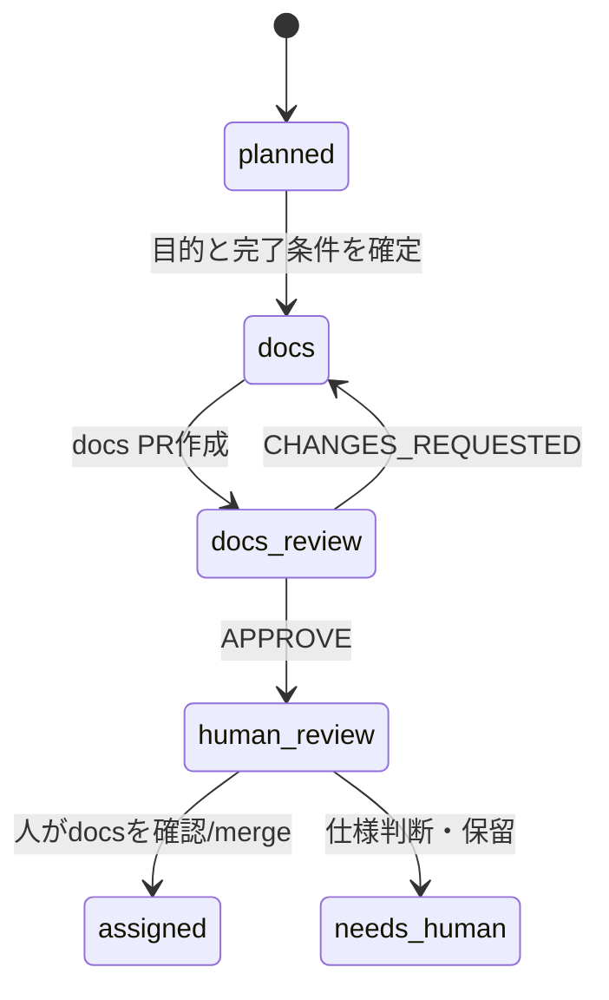
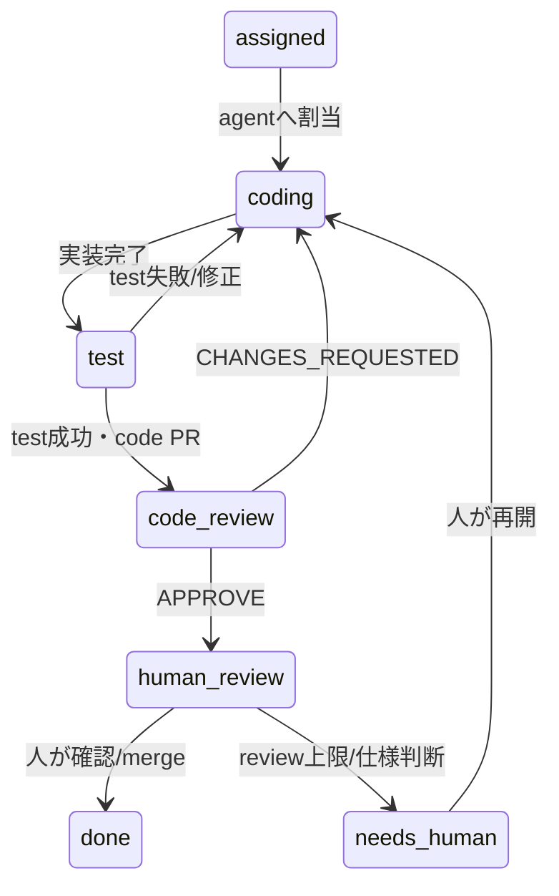

# Workflow state machine

## docsから人のmergeまで



## 実装から人のmergeまで



## metadataの意味

`phase`、`state`、`task_status`を混ぜない。

| key | 例 | 意味 |
|---|---|---|
| `phase` | `docs`, `coding`, `test`, `code_review` | 作業の段階 |
| `state` | `busy`, `waiting_user`, `blocked`, `stale`, `needs_human` | agent/taskの現在状態 |
| `task_status` | `planned`, `ready`, `in_progress`, `ready_for_review`, `done` | taskの進行状態 |

通常の人確認待ちは`waiting_user`、レビュー上限・権限・仕様判断のエスカレーションは
`needs_human`とする。

## stale

初期設定:

```yaml
heartbeat_interval_seconds: 60
stale_after_seconds: 600
```

`stale_after_seconds`はheartbeat intervalの10倍以上でなければならず、設定読み込み時に
拒否する。599秒はstaleではなく、600秒以上でstaleになる境界testを持つ。
