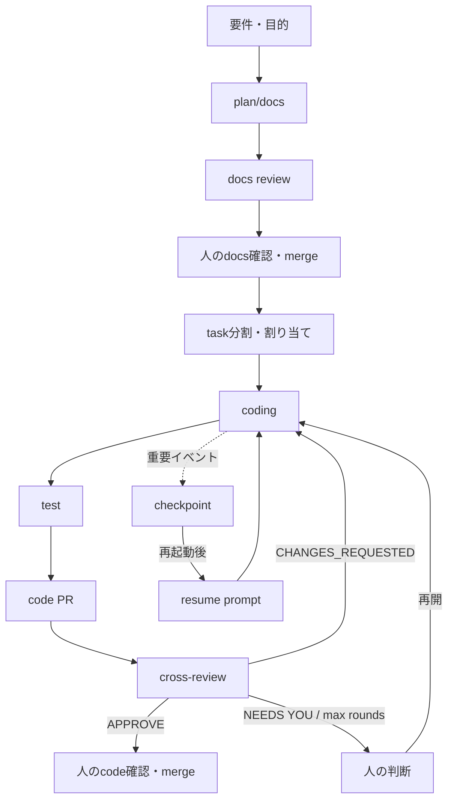
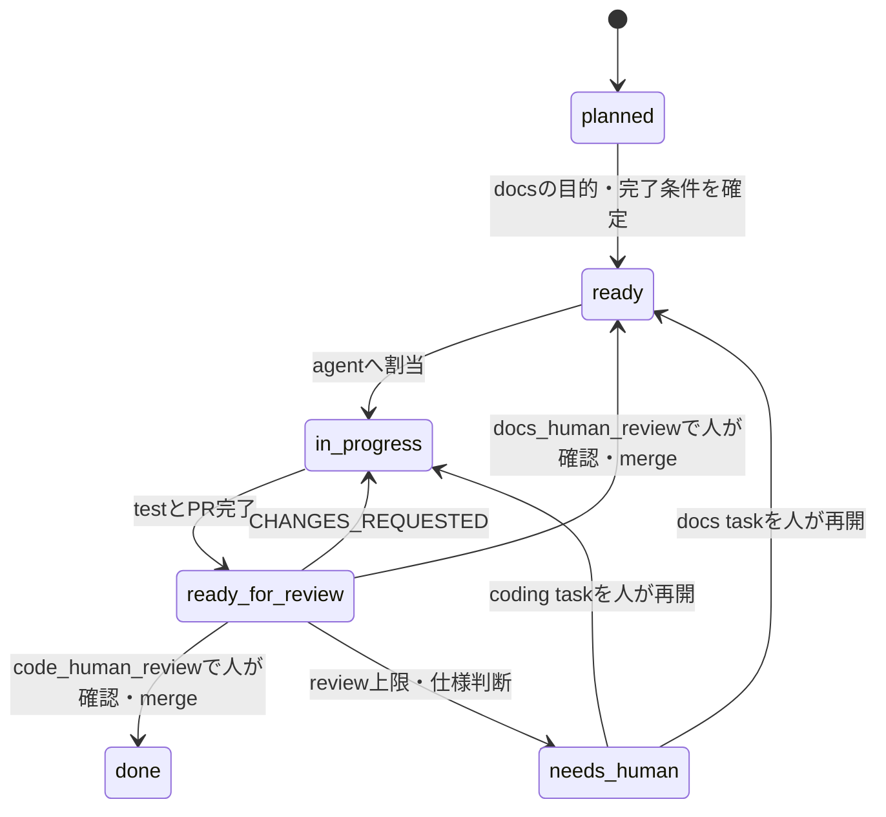

# Workflow state machine

## workflow全体



`checkpoint`はtaskの進行を表す`phase/state/task_status`とは別の復元用metadataである。`resume`は自動で実装を再開せず、人がbranch・PR・未commit変更を確認してからagentへ指示する。

## task_statusの遷移

下の図は`task_status`だけを表す。`phase`と`state`は直交するmetadataであり、図のnode名に
混ぜない。



## phaseとstateの組み合わせ

| phase | task_status | 通常のstate | 説明 |
|---|---|---|---|
| `docs` / `docs_review` | `in_progress` / `ready_for_review` | `busy` | docsを作成・review中 |
| `docs_human_review` | `ready_for_review` | `waiting_user` | docsの人確認待ち |
| `assigned` / `coding` | `in_progress` | `busy` | 実装taskを進めている |
| `test` | `in_progress` | `busy` / `blocked` | test中または失敗で停止 |
| `code_review` | `ready_for_review` | `busy` / `waiting_user` | code PRのreview中 |
| `code_human_review` | `ready_for_review` | `waiting_user` | merge前の人確認 |
| any | `needs_human` | `needs_human` | review上限・権限・仕様判断 |
| `done` | `done` | `done` | mergeまたは引渡し済み |

## metadataの意味

`phase`、`state`、`task_status`を混ぜない。

| key | 例 | 意味 |
|---|---|---|
| `phase` | `docs`, `docs_review`, `docs_human_review`, `assigned`, `coding`, `test`, `code_review`, `code_human_review`, `done` | 作業の段階 |
| `state` | `busy`, `waiting_user`, `blocked`, `stale`, `needs_human`, `idle`, `done` | agent/taskの現在状態 |
| `task_status` | `planned`, `ready`, `in_progress`, `ready_for_review`, `needs_human`, `done` | taskの進行状態 |

通常の人確認待ちは`waiting_user`、レビュー上限・権限・仕様判断のエスカレーションは
`needs_human`とする。`needs_human`から再開する場合は、docs taskなら`ready`、coding taskなら
`in_progress`へ戻す。表にないphase/state/task_statusの組み合わせはschemaで拒否する。
`idle`は未割当の`planned`/`ready` taskに使い、`blocked`/`stale`は他のphase/statusへ重畳する。

## stale

初期設定:

```yaml
heartbeat_interval_seconds: 60
stale_after_seconds: 600
```

`stale_after_seconds`はheartbeat intervalの10倍以上でなければならず、設定読み込み時に
拒否する。599秒はstaleではなく、600秒以上でstaleになる境界testを持つ。
